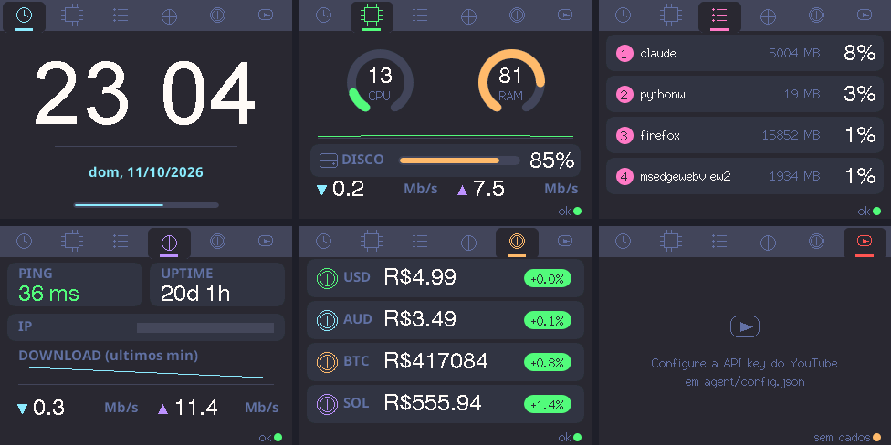
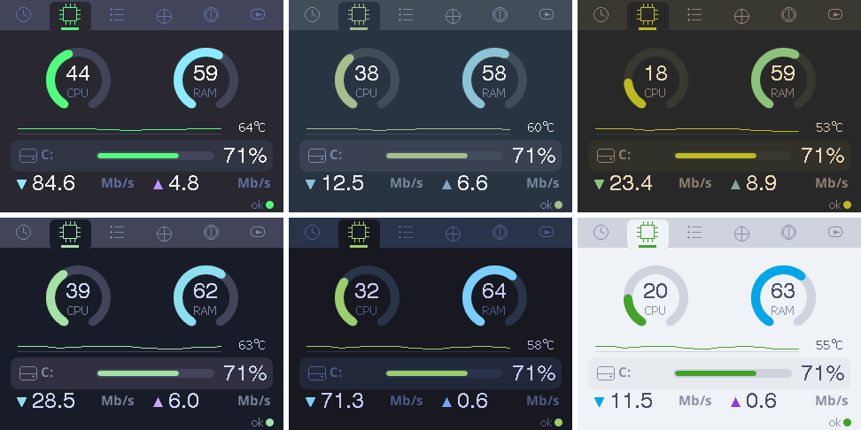
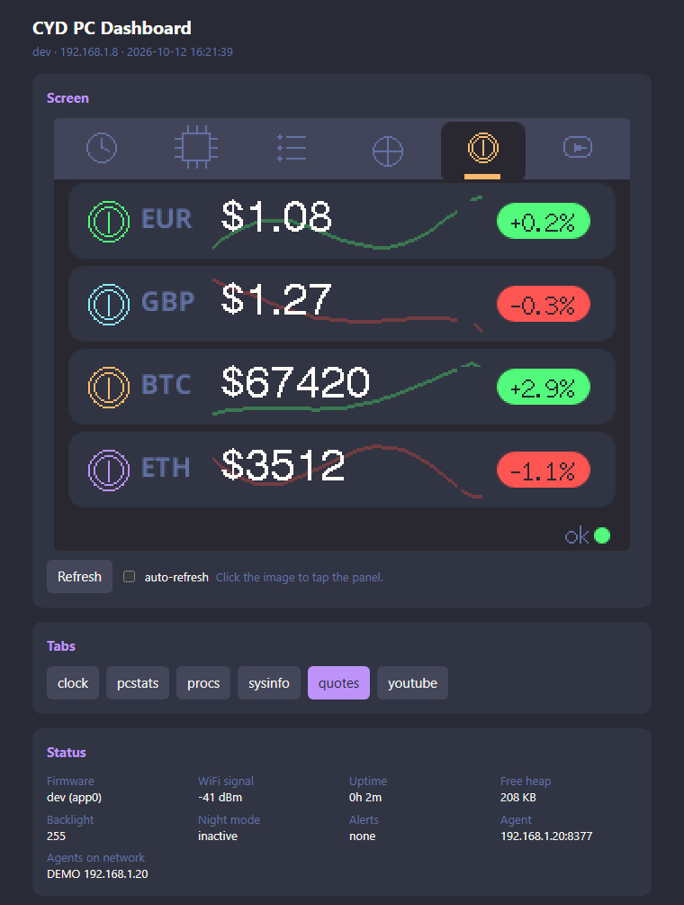
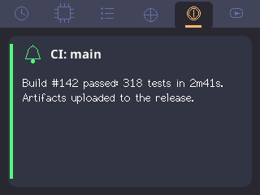

# CYD PC Dashboard

[](https://github.com/DaviLuisSantos/cyd-pc-dashboard/actions/workflows/build.yml)
[](https://github.com/DaviLuisSantos/cyd-pc-dashboard/releases/latest)


A touch-screen **desk companion for your PC**, built on the ~US$15 **ESP32-2432S028R** ("Cheap Yellow Display", 2.8" ILI9341 + XPT2046 touch). It sits next to your monitor and shows, at a glance, what you'd otherwise alt-tab for: CPU/RAM/disk, top processes, network health, market quotes and YouTube channel stats.



<sub>Real captures read back from the display's framebuffer through the panel's web interface (see [Screenshots](#screenshots)), fed by the demo agent so no personal data shows up.</sub>

**[⚡ Flash it from your browser](https://daviluissantos.github.io/cyd-pc-dashboard/)**: no toolchain needed.

## Features

| Tab | What it shows |
| --- | --- |
| **Clock** | Time/date via NTP, blinking colon, seconds progress bar |
| **PC** | Animated ring gauges for CPU and RAM, CPU history sparkline with CPU temperature, disk usage bar (cycles through several disks; tap it to skip), live network throughput |
| **Processes** | Top 4 processes by CPU (instances aggregated by name) with memory usage; noise like the agent itself can be filtered out |
| **Network** | Latency (TCP ping), PC uptime, public IP, download history sparkline |
| **Quotes** | Any fiat currency or crypto, in any base currency, with rolling price animation, daily % change badge and a faint 24 h chart behind each price |
| **YouTube** | Subscribers / views / video count for up to 3 channels |

- **Zero-code setup**: the web installer sets up WiFi right after flashing (Improv Wi-Fi), or the panel opens a captive portal where you pick your network, agent IP, timezone and language. Settings live in the board's flash.
- **Web interface on the panel itself**: live screenshot you can click to tap, tab switching, every setting editable and applied instantly, and **firmware updates over WiFi (OTA)**, plus a JSON API for all of it
- **Notifications from your PC**: `notify.py "Build passed"` (or a plain `curl`) pops a card on the panel, colored by level, queued, and it wakes the screen at night. Handy for builds, tests, downloads and long commands
- **Threshold alerts**: CPU/RAM/disk limits color the gauges and make the PC tab icon blink red from any tab (optionally jumping to it)
- **Night mode**: dimmed or fully off backlight during a time window; a tap wakes the screen
- **Browser flashing** via [ESP Web Tools](https://esphome.github.io/esp-web-tools/), with versioned GitHub Releases built by CI
- **Color themes**: Dracula (default), Nord, Gruvbox, Catppuccin Mocha, Tokyo Night and Catppuccin Latte (light), switchable at runtime; the web interface follows the panel's theme
- Anti-aliased shapes and fonts, 100% vector icons (no SPIFFS/LittleFS, no bitmaps)



- **Flicker-free rendering**: only changed regions are redrawn, through off-screen sprites pushed atomically
- **Tab navigation** by touch, plus optional auto-rotation between tabs
- **Agent-based architecture**: the ESP32 only speaks plain HTTP on your LAN; a tiny Python agent on the PC collects metrics and caches external APIs (no API keys or TLS on the microcontroller)
- **Bilingual UI** (English / Brazilian Portuguese), switchable at runtime

## Architecture

```
┌────────────────────┐   HTTP/JSON (LAN)   ┌────────────────────────┐   HTTPS
│  ESP32 CYD panel   │ ──────────────────► │  pc_stats_agent.py     │ ───────► AwesomeAPI (fiat)
│  C++ / PlatformIO  │  /stats /procs      │  psutil + stdlib only  │ ───────► CoinGecko (crypto)
│  TFT_eSPI sprites  │  /sysinfo /quotes   │  background threads,   │ ───────► YouTube Data API
│  WiFiManager       │  /youtube           │  in-memory cache       │ ───────► ipify (public IP)
└────────────────────┘                     └────────────────────────┘
```

Every metric is collected by a dedicated background thread and the HTTP handlers only read from cache, so the panel can poll every couple of seconds without hammering external APIs. It's also the only correct way to measure CPU with `psutil`: `cpu_percent(interval=None)` measures since the *previous call on the same thread*, and `ThreadingHTTPServer` spawns a new thread per request, so calling it in a handler always returns 0.

### Engineering notes

A few things that weren't obvious while building this:

- **Shared SPI peripheral, broken reads.** TFT_eSPI defaults to the ESP32's VSPI peripheral, and so does the touch controller. Writes worked because the GPIO matrix can fan one output out to two pins. Display *reads* returned all zeros, though: `touchSPI.begin()` re-routed the peripheral's single MISO input to the touch pin. The fix was `-DUSE_HSPI_PORT`, which gives the display its own peripheral.
- **Readback at 20 MHz shifts bits.** Reading the ILI9341 framebuffer at the write clock returns every byte shifted by one bit. Reads now run at 6 MHz, while writes stay at 55 MHz.
- **Inverted colors on some boards.** Many CYD units show inverted colors with the `ILI9341_2_DRIVER` init sequence, so the polarity is a config flag (`DISPLAY_INVERT`).
- **Sprites over text padding.** Each dynamic value is drawn in a small `TFT_eSprite` and pushed in one transaction. That removes the flicker of clear-then-draw, and the sprite is freed right away so it doesn't hold RAM the WiFi stack needs.

## Getting started

### 1. Flash the panel

**Easiest:** open the [web installer](https://daviluissantos.github.io/cyd-pc-dashboard/) in Chrome or Edge, plug the board in and click *Install*.

**From source** (PlatformIO):

```bash
pio run -t upload
```

> Some CYD boards don't enter download mode on their own (`Wrong boot mode detected`). Hold **BOOT**, tap **RST**, release **BOOT**, then flash.

### 2. Configure it

**If you used the web installer**, it offers **Connect to Wi-Fi** right after flashing: pick your network in the browser and you're done (this uses [Improv Wi-Fi](https://www.improv-wifi.com/) over the same USB connection). The installer's *Connect* button also works later on an already-flashed panel, to change the network or open its web interface. Everything else (agent, timezone, tabs...) can then be set from the panel's web interface.

Otherwise, on first boot the panel shows setup instructions and creates a WiFi network called **`CYD-Dashboard`**. Join it from your phone, open `http://192.168.4.1`, then pick your WiFi and fill in:

| Field | Example |
| --- | --- |
| Agent IP | `auto` (default) finds the agent on your network by itself. Or type the PC's LAN address, e.g. `192.168.1.50` |
| Agent port | `8377` |
| Agent token | Only if the agent's `config.json` sets a `token` (see below) |
| Timezone | POSIX TZ string: `<-03>3`, `EST5EDT,M3.2.0,M11.1.0`, `CET-1CEST,M3.5.0,M10.5.0/3`, `UTC0` ([full list](https://github.com/nayarsystems/posix_tz_db/blob/master/zones.csv)) |
| Language | `en` or `pt` |
| Theme | `dracula`, `nord`, `gruvbox`, `mocha`, `tokyonight` or `latte` (light) |
| Clock | `24` or `12` (AM/PM) |
| Date format | `auto` (by language), `long` (Mon, Oct 12 2026), `dmy` (12/10/2026), `mdy` (10/12/2026), `ymd` (2026-10-12) |
| Tabs | Which tabs to show and in what order; the first one is the start tab. IDs: `clock`, `pcstats`, `procs`, `sysinfo`, `quotes`, `youtube`. Example: `pcstats,procs,quotes` |
| Auto-rotate | Seconds between automatic tab changes (`0` = off) |
| Brightness | `10`–`255` |
| Rotation | `1` = USB on the right, `3` = USB on the left |
| Invert colors | Toggle this if the background shows white/light gray |
| Alert CPU / RAM / disk / temperature | Percent limits, and °C for the CPU temperature (`0` = off; the disk alert uses the fullest disk). Gauges turn red from the limit and orange 20 points below. Above the limit for 10 s, the PC tab icon blinks red on any tab |
| Jump to PC tab on alert | Switch to the PC tab when an alert starts |
| Night mode from / until | Local time window (e.g. `23:00` → `07:00`) with dimmed backlight. Same value in both = off |
| Night brightness | `0`–`255`. `0` turns the screen off; a tap wakes it for 30 s (that tap doesn't switch tabs) |

**To change settings later**, open the panel's web interface (next section), or hold the screen while the panel boots until the progress bar fills up to reopen the setup portal.

### Web interface and OTA updates



Once the panel is on your WiFi, open **`http://cyd-dashboard.local/`** (or `http://<panel-ip>/`; the serial command `i` prints the IP). From there you can:

- see a live screenshot of the panel and click it to tap the screen;
- switch tabs;
- edit every setting from the table above (applied immediately, no reboot);
- **update the firmware over WiFi**: upload `.pio/build/cyd/firmware.bin` or the `*-ota.bin` file from a [release](../../releases). The merged installer image is rejected.

Set a web password in the portal or the web interface to protect it (HTTP Basic, user `admin`). Without one, anyone on your LAN can use it.

The same features are available as a JSON API:

| Endpoint | Description |
| --- | --- |
| `GET /api/status` | Version, IP, uptime, current tab, backlight, night mode, alerts, OTA slot/rollback state |
| `GET/POST /api/settings` | Read settings / change any subset: `{"bright": 120, "screens": "pcstats,quotes"}` |
| `POST /api/tab?id=quotes` | Switch tab (`id`, `index` or `next`) |
| `POST /api/touch?x=160&y=120` | Simulate a tap |
| `GET /screenshot.bmp` | Current screen |
| `GET /theme.css` | CSS variables of the current theme (the page follows the panel's theme) |
| `POST /api/update` | Firmware update (multipart upload) |
| `POST /api/notify` | Show a notification: `{"text", "title", "level": "info\|ok\|warn\|error", "duration": 8}` (JSON or form fields) |
| `POST /api/reboot` | Reboot |

```bash
curl -F firmware=@.pio/build/cyd/firmware.bin http://cyd-dashboard.local/api/update
```

**Safe updates:** a new firmware has to prove it works (WiFi connected and running for 15 s) before it's kept. If it crashes on boot, the panel goes back to the previous version on the next reset. If it hangs without crashing, it goes back after 2 minutes. Either way, the panel shows a notification saying which version failed, and `/api/status` reports it under `ota.rolled_back_from`. So a bad update never needs the BOOT/RST buttons.

> Boards flashed before OTA support used a partition table without a second app slot: flash once over USB to switch, after that updates can go over WiFi. Settings are kept.

### Notifications



Anything on your network can pop a notification on the panel. It shows as a card over the current tab, colored by level, with a countdown bar. Notifications queue up (the card shows how many are waiting), a tap dismisses one, and they wake the screen during night mode. The display fonts have no accents, so `ação` shows as `acao`.

`agent/notify.py` needs only the Python standard library. It finds the panel at `cyd-dashboard.local`, or at `panel.host` in `agent/config.json`:

```bash
python agent/notify.py "Build #142 passed" --title CI --level ok
python agent/notify.py "Backup failed" --level error --duration 0     # stays until tapped
make 2>&1 | tail -n 1 | python agent/notify.py --title make            # text from stdin
./long-task.sh && python agent/notify.py "Done" --level ok || python agent/notify.py "Failed" --level error
```

Or straight from `curl`, no script needed:

```bash
curl -d "text=Download finished&level=ok" http://cyd-dashboard.local/api/notify
```

Levels: `info` (default), `ok`, `warn`, `error`. `duration` is in seconds (default 8, `0` = until tapped). If the web interface has a password, pass `--password` (or set `panel.password`).

### 3. Run the agent on your PC

Requires Python 3.8+.

```bash
pip install -r agent/requirements.txt
cp agent/config.example.json agent/config.json   # optional: currencies, YouTube, ...
python agent/pc_stats_agent.py
```

Check it in a browser at `http://localhost:8377/stats`, and allow port **8377** on your firewall for the private network.

**Start with Windows:** double-click `agent/install_autostart.bat`. It registers a Task Scheduler task that runs the agent at logon with `pythonw` (no console window), logging to `agent/agent.log`. No admin rights needed; `uninstall_autostart.bat` removes it. `start_agent.bat` / `stop_agent.bat` / `restart_agent.bat` are there for manual control.

**Start with Linux or macOS:** run `./agent/install_autostart.sh`. No root needed, and running it again just updates the registration.

- **Linux:** registers a systemd *user* service that starts at login and restarts if it crashes. Logs: `journalctl --user -u cyd-pc-dashboard-agent -f`. Add `--linger` to start it at boot, before anyone logs in.
- **macOS:** registers a launchd LaunchAgent that starts at login, logging to `agent/agent.log`. The first time, macOS may ask whether Python can accept incoming connections: allow it, or the panel can't reach the agent.

It uses `agent/.venv` if there is one, otherwise `python3` from your `PATH`, and checks that `psutil` is installed first. `--dry-run` shows what it would do without changing anything. `./agent/uninstall_autostart.sh` removes it.

## Configuration

### Agent: `agent/config.json`

Every key is optional; missing keys use `DEFAULT_CONFIG` in the script. This file is git-ignored.

```jsonc
{
  "port": 8377,
  "bind": "0.0.0.0",
  "token": "",                    // shared secret; empty = no auth (see "Securing the agent")
  "disk_path": null,              // partition shown on the PC tab (null = system root)
  "disks": null,                  // several disks: "all" (every fixed partition) or
                                  // ["C:\\", {"path": "D:\\", "name": "GAMES"}] (names: ASCII, max 8 chars)
  "top_procs": 4,
  "procs": {
    "ignore": ["svchost", "msedge*"],  // hidden from the Processes tab (case-insensitive, .exe optional, * and ? wildcards)
    "ignore_self": true           // hide the agent itself (by PID, other Python processes still show)
  },
  "ping": { "host": "8.8.8.8", "port": 53 },
  "temperature": {                // CPU temperature on the PC tab (see "CPU temperature" below)
    "source": "auto",             // auto | psutil | lhm | off
    "lhm_url": "http://localhost:8085/data.json",
    "sensor": null                // force a sensor by name, e.g. "Package" or "Tctl"
  },

  "quotes": {
    "enabled": true,
    "base": "USD",                // currency prices are quoted in
    "prefix": "$",                // shown before prices (ASCII only, e.g. "R$", "EUR ")
    "history_hours": 24,          // chart window behind each price
    "history_points": 32,         // points sent to the panel
    "assets": [                   // the panel shows the first 4, in this order
      { "symbol": "EUR", "type": "fiat" },                      // AwesomeAPI pair EUR-USD
      { "symbol": "BTC", "type": "crypto", "id": "bitcoin" }    // CoinGecko coin id
    ]
  },

  "youtube": {
    "api_key": "",                // or the YOUTUBE_API_KEY environment variable
    "channel_ids": ["UC..."]
  },

  "discovery": {                  // lets panels set to "auto" find this agent
    "enabled": true,
    "port": 8377,                 // UDP broadcast port (DISCOVERY_PORT on the firmware)
    "interval": 5,                // seconds between announcements
    "name": null                  // announced name (null = PC hostname)
  },

  "panel": {                      // used by agent/notify.py (not by the agent itself)
    "host": "cyd-dashboard.local",
    "password": ""                // the panel's web interface password, if set
  }
}
```

Command-line overrides: `--config path/to/config.json`, `--port N`, `--log file.log`.

#### Quote history

Each quote card shows the last 24 hours as a faint chart behind the price, green or red by trend. Crypto history comes ready from CoinGecko when the agent starts. For fiat, the AwesomeAPI only has sparse points, so the agent starts with those and fills in with its own polls (every 60 s). Until a full day is collected, the chart covers only the recent part, on the right. History is saved to `agent/quotes_history.json` (git-ignored), so restarting the agent keeps it.

#### CPU temperature

The PC tab shows the CPU temperature next to the CPU history graph when the agent can read it. If it can't, the graph uses the full width.

- **Linux:** works out of the box through `psutil` (`coretemp`, `k10temp`, Raspberry Pi `cpu_thermal`...).
- **Windows:** `psutil` can't read temperatures there. Install [LibreHardwareMonitor](https://github.com/LibreHardwareMonitor/LibreHardwareMonitor), run it (as administrator, so it can read the sensors) and turn on *Options → Remote Web Server* (port 8085). The agent picks it up automatically, even if you open it after the agent started.

The agent prefers the whole-package sensor (`CPU Package` on Intel, `Tctl/Tdie` on AMD), otherwise the hottest core. Use `temperature.sensor` to force one.

#### Securing the agent

By default anyone on your LAN can read the agent's data (process list, public IP...). To restrict it, set a token and enter the same value as *Agent token* on the panel (portal or web interface):

```bash
python -c "import secrets; print(secrets.token_urlsafe(16))"
```

```jsonc
{ "token": "paste-it-here" }   // or set the CYDPC_AGENT_TOKEN environment variable
```

Requests then need the `X-Agent-Token` header (or `?token=...` in the URL, handy for testing in a browser), otherwise the agent answers `401`. Discovery announcements only say that a token is required, never the token itself. Traffic is plain HTTP, so this keeps other devices on the network out, but it doesn't protect against someone capturing your LAN traffic.

### Firmware build options: `src/user_config.h`

Optional, for people building from source. Copy `src/user_config.example.h` to `src/user_config.h` (git-ignored) and define only what you want to change; everything else falls back to [`src/config.h`](src/config.h). Values set in the setup portal take precedence over the defaults defined here (agent host/port, timezone, language, theme, clock and date format, tab order, auto-rotate, brightness, rotation, color inversion and night mode).

| Option | Default | Description |
| --- | --- | --- |
| `WIFI_SSID` / `WIFI_PASSWORD` | — | Pre-baked WiFi (skips the portal) |
| `AGENT_HOST` / `AGENT_PORT` | `"auto"` / `8377` | Default agent address; `"auto"` = discover it on the LAN |
| `AGENT_TOKEN` | `""` | Token matching the agent's `token` (empty = agent without auth) |
| `DISCOVERY_PORT` | `8377` | UDP port the agent announces itself on |
| `PANEL_LANG` | `LANG_EN` | Default UI language: `LANG_EN` or `LANG_PT_BR` |
| `TZ_INFO` | `UTC0` | Default POSIX timezone |
| `THEME` | `"dracula"` | `dracula`, `nord`, `gruvbox`, `mocha`, `tokyonight` or `latte` |
| `CLOCK_FORMAT` | `24` | `24` or `12` (AM/PM) |
| `DATE_FORMAT` | `"auto"` | `auto`, `long`, `dmy`, `mdy` or `ymd` |
| `ENABLE_SCREEN_*` | `1` | Compile tabs in/out: `CLOCK`, `PCSTATS`, `PROCS`, `SYSINFO`, `QUOTES`, `YOUTUBE` |
| `SCREEN_ORDER` | `"clock,pcstats,procs,sysinfo,quotes,youtube"` | Default tab list and order (first = start tab) |
| `AUTO_NEXT_MS` | `10000` | Auto-rotate tabs after this idle time (`0` disables) |
| `DISPLAY_ROTATION` | `1` | `1` = USB on the right, `3` = USB on the left |
| `DISPLAY_INVERT` | `true` | Flip if colors look inverted on your board |
| `BACKLIGHT_LEVEL` | `255` | Brightness, 0–255 |
| `ALERT_CPU` / `ALERT_RAM` / `ALERT_DISK` | `90` / `90` / `95` | Alert limits in % (`0` = off) |
| `ALERT_TEMP` | `85` | CPU temperature alert in °C (`0` = off) |
| `ALERT_JUMP` | `false` | Jump to the PC tab when an alert starts |
| `DISK_CYCLE_MS` | `5000` | With several disks, how long each one stays on the PC tab |
| `ALERT_HOLD_MS` | `10000` | How long a value must stay above the limit to raise an alert |
| `NIGHT_START` / `NIGHT_END` | `"00:00"` / `"00:00"` | Night mode window, `"HH:MM"` local time (equal = off) |
| `NIGHT_BRIGHTNESS` | `0` | Backlight during night mode (`0` = off, tap to wake) |
| `NIGHT_WAKE_MS` | `30000` | How long a tap keeps the screen on at night |
| `*_POLL_MS` | various | Poll interval of each agent endpoint |
| `OTA_VERIFY_MIN_MS` / `OTA_VERIFY_TIMEOUT_MS` | `15000` / `120000` | A new firmware is kept after WiFi + this long running; rolled back if not healthy by the timeout |
| `NOTIFY_DEFAULT_S` | `8` | How long a notification stays when the request doesn't say |
| `WEB_PASSWORD` | `""` | Web interface password (user `admin`); empty = open |
| `MDNS_NAME` | `cyd-dashboard` | Hostname: `http://<name>.local/` |
| `TOUCH_MIN/MAX_X/Y`, `TOUCH_DEBUG` | — | Touch calibration; `TOUCH_DEBUG 1` logs raw readings over serial |

## Agent API

| Endpoint | Example response |
| --- | --- |
| `GET /stats` | `{"cpu": 23.5, "ram": 61.2, "disk": 54.0, "disks": [{"name": "C:", "pct": 54.0, "used_gb": 540.2, "total_gb": 999.1}], "disk_read_mbps": 1.02, "disk_write_mbps": 11.88, "net_down_mbps": 4.31, "net_up_mbps": 0.87}` |
| `GET /procs` | `{"procs": [{"name": "chrome", "cpu": 12.3, "mem_mb": 1840}, ...]}` |
| `GET /sysinfo` | `{"ping_ms": 14.2, "public_ip": "203.0.113.7", "uptime_s": 86400, "net_down_mbps": 4.3, "net_up_mbps": 0.9}` |
| `GET /quotes` | `{"base": "USD", "prefix": "$", "items": [{"symbol": "BTC", "price": 83799.0, "change_pct": 1.07, "history": [82950.1, ...]}, ...], "updated_at": 1791766163}` |
| `GET /youtube` | `{"configured": true, "channels": [{"title": "...", "subs": 1234, "views": 56789, "videos": 42}], "updated_at": 1791766163}` |

> The agent has no authentication. Keep it on a trusted LAN, or set `"bind"` to a specific interface.

## Screenshots

The firmware accepts one-character commands on the serial port (115200 baud):

| Key | Action |
| --- | --- |
| `s` | Dump the display framebuffer (RGB565) |
| `n` | Next tab |
| `a` | Toggle tab auto-rotation |
| `r` | Erase the portal settings and reboot |
| `i` | Print version, IP and the web interface address |

`tools/screenshot.py` captures the display either through the web interface (no cable, stdlib only) or over serial (needs `pyserial`), and writes PNGs to `docs/screenshots/`:

```bash
python tools/screenshot.py --host cyd-dashboard.local --tabs 6 --grid 3        # tab1..6.png + overview.png
python tools/screenshot.py --host cyd-dashboard.local --themes dracula,nord,gruvbox,mocha,tokyonight,latte --grid 3   # themes.png
python tools/screenshot.py --port COM3 --tabs 6                                # over serial
```

For public screenshots, run **`tools/demo_agent.py`** instead of the real agent: it serves plausible fake data on every endpoint (generic processes and channels, a documentation-range public IP), so nothing personal ends up in the images. It's also a quick way to try the panel without setting up the agent.

## Adding a new tab

1. Create `src/screen_mytab.h` with a class deriving from `Screen` (see [`src/screens.h`](src/screens.h)): implement `name()`, `drawIcon()`, `onEnter()` (static layout, drawn once) and `update()` (redraw only what changed).
2. Fetch data with `agent::fetch(tft, "/myendpoint", doc)` from [`src/agent_client.h`](src/agent_client.h). It handles WiFi, agent and JSON errors and the status indicator for you.
3. Use the `THEME_*` colors (never `TFT_*` or raw RGB565, or your tab won't follow the theme) and widgets from [`src/theme.h`](src/theme.h) (`drawCard`, `drawBar`, `drawRingGauge`, `drawSparkline`, `drawPctBadge`, vector icons...) and put user-facing text in [`src/i18n.h`](src/i18n.h).
4. Register it in `main.cpp`: add an entry with its ID to `allScreens[]`, behind an `ENABLE_SCREEN_*` flag, and add the ID to `SCREEN_ORDER` in `config.h`.

## Releasing

Pushing a `vX.Y.Z` tag runs [`release.yml`](.github/workflows/release.yml), which:
1. builds the firmware with the version embedded;
2. merges bootloader, partitions and app into a single binary;
3. publishes a GitHub Release with the merged image (for USB/web installer) and the `*-ota.bin` app image (for updates through the panel's web interface);
4. deploys the web installer to GitHub Pages.

## Troubleshooting

- **Background shows white/light gray**: toggle *Invert colors* in the setup portal (or `DISPLAY_INVERT`).
- **Touch is offset**: set `TOUCH_DEBUG 1`, tap the corners, and adjust `TOUCH_MIN/MAX_X/Y`.
- **"agent offline"**: open `http://<agent-ip>:8377/stats` from another device on the LAN. It's usually the firewall (TCP 8377 must be allowed on private networks), or the PC's IP changed: set the agent IP to `auto`, or reserve a static DHCP lease.
- **"bad token"**: the agent has a `token` and the panel's *Agent token* is missing or different. Set the same value in the portal or web interface.
- **"finding agent"**: the agent IP is `auto` and no announcement arrived yet. Check that the agent is running with `discovery.enabled` and that the PC and the panel are on the same subnet (broadcasts don't cross routers). The web interface lists every agent the panel has heard.
- **Windows: agent changes don't show up**: stale Python processes may be sharing port 8377. Run `stop_agent.bat`, then start it again.

## Roadmap

- [x] CPU temperature (Linux via `psutil`; Windows via LibreHardwareMonitor)
- [x] Optional token auth for the agent
- [x] Improv Serial, so WiFi can be set from the web installer
- [x] Agent discovery on the LAN, so the IP doesn't have to be typed in

## License

[MIT](LICENSE)
